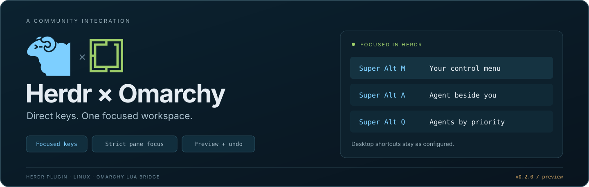

<p align="center"></p>

# Herdr × Omarchy

**One chord for your everyday Herdr actions.** Split, swap, navigate, launch agents,
and open Lazygit with **Super+Alt**, while keeping your Omarchy shortcuts.

Herdr Shell (`blr.herdr-shell`) uses your existing Herdr's plugin system and API.
An Omarchy companion manages the Herdr plugin and a Hyprland bridge that checks
conflicts before routing free chords to focused local Herdr. Your Herdr binary,
desktop bindings, and appearance settings stay in place. This is a development preview.

## Install

Requires **Linux, Herdr 0.9.3+, Python 3.11+, curses, and tomlkit**. Direct shortcuts
also require Omarchy's **Lua Hyprland config**, its `require("default.hypr.omarchy")`
loader, `hyprctl`, and `luac`. Agents use Omarchy's configured default, or its picker;
Lazygit requires `lazygit`. Editor/files popups use `$VISUAL`/`$EDITOR` (default
`nvim`) and `yazi` or `ranger`.

Run from **any terminal**:

```sh
sudo pacman -S --needed git python python-tomlkit lua
omarchy plugin add https://github.com/baileyrosen3/omarchy-herdr.git --enable
```

Omarchy clones the repository automatically. The companion sets up Herdr and
free desktop shortcuts in the background within a few seconds. Tabs follow the
task title of the agent running in them and new workspaces take the project name;
adjust both in **Settings → Behavior → Names**. If Herdr is not running yet, open
it normally; no restart is needed. Add `~/.local/bin` to `PATH` for `herdr-shell`.

**Migrating from a developer-linked installation?** From any Herdr pane, run
`herdr-shell remove --apply` before the Omarchy add command. It keeps the old
checkout, settings, and history. The companion preserves an existing developer
installation until you remove its integration. See [Contributing](CONTRIBUTING.md)
for the checkout-based development workflow.

**Super+Alt+M** opens/closes the menu. Existing **Super+Ctrl+Enter** still opens
Herdr, and **Super+Space** keeps the Omarchy menu. An occupied chord stays with its
owner; all other free shortcuts still install. The menu reports which are ready.
Native recovery uses your Herdr prefix,
then **Space** for the menu or **Alt+K** for keybindings. With Omarchy's Ctrl+Space
prefix, press it, release, then press Space. If a recovery key is already used,
that menu action installs unbound; use `herdr-shell menu` or choose a free key in
Herdr's keybinding settings. Your existing custom recovery keys are preserved.
Outside Herdr, or with the profile off, its chords pass through to the focused app.

## All 26 direct shortcuts

Hold **Super+Alt**, then press the key below. Shift is written explicitly.

| Key | Action |
| --- | --- |
| **M** | Toggle the control menu |
| **U / D / L / R** | Split above / below / left / right |
| **Shift+U / Shift+D / Shift+L / Shift+R** | Swap with the pane above / below / left / right |
| **J** | Rotate the nearest two-pane split between stacked and side by side |
| **Z** | Zoom / restore the pane |
| **X** | Close the pane |
| **P / Shift+P** | Next / previous pane, continuing through tabs and workspaces |
| **T / W** | Create / close a tab |
| **Shift+T / Shift+W** | Create / close a workspace |
| **PageUp / PageDown** | Previous / next tab, continuing through workspaces |
| **Shift+PageUp / Shift+PageDown** | Previous / next workspace |
| **A** | Start your default Omarchy agent in a pane to the right |
| **Q / Shift+Q** | Next / previous agent by priority |
| **V** | Open Lazygit in a pane to the right |

Omarchy's native **Ctrl+Alt+arrows** focus neighboring panes; focus stops at an
edge. **Ctrl+Alt+Shift+arrows** resize. **P** goes to the next pane, then the next
tab's first pane, then the next workspace. **Shift+P** reverses that order.
**PageUp/PageDown** switch tabs across workspace boundaries, restoring each tab's
selected pane. These pane/tab cycles wrap around the session; **Shift+PageUp/PageDown**
jump directly between workspaces. Native Herdr pane/tab cycle keys keep their
native scope; these cross-workspace commands use the Super+Alt profile or menu.
New panes, tabs, workspaces, agents, and Lazygit inherit the originating directory.
New workspaces take the Git project name (or the directory outside Git). Tabs
take the task title of the agent running in them, and split panes stay unlabeled
(see [Names](#names)).
Agent sweeps visit **approval/input → done → working → idle**, keeping their order
stable through each sweep so status changes cannot trap you on one agent.
Closing an idle shell runs directly; by default, agents, running work, and uncertain
activity require confirmation with **Cancel selected first**. Turn off **Confirm
pane close** in Settings to close panes immediately. Tab/workspace close still
checks all affected panes. Menu and direct close commands use the same policy.

## The control menu

Home uses the **same header, sidebar, action list, and details layout** as every
other main section. It retains **all 26 direct shortcuts**, with full chords and
live availability markers. **F1** explains the selected action and any restriction.
Sections are ordered by purpose: **Home, Panes, Tabs, Workspaces, Agents, Tools,
Settings, Learn, All**. Panes groups creation/arrangement, focus/navigation, and
resizing/closing; All follows the same logical groups instead of alphabetic order.
Search reaches every action regardless of the selected section.

Type to search, **↑↓** to select, **Enter** to act, **Tab/Shift+Tab** or **←/→** to
change sections (categories inside Settings), and **Esc** to clear search, go back,
or close. **F2** opens Keybindings,
**Ctrl+O/F3** Settings, **Ctrl+R** refreshes, and **Ctrl+Z/F4** reviews config undo.
Search and selection survive editing and refresh. The menu uses your terminal
palette and retains the Herdr/Omarchy branding; minimum size is **46 × 16**.

## Shortcut footer

The footer provider shows **one row** of active shortcuts, with **M Menu** first
and fewer hints in narrow windows. It follows Herdr's colors and leaves tabs at
the top. Conflicted keys stay out of the hints.

**Stock Herdr 0.9.3 cannot draw this footer yet.** The plugin enables it only when
Herdr explicitly advertises native footer support; normal installation never
replaces your Herdr binary. The isolated native extension and validation notes are
in [Footer support](docs/footer.md). Preview the hints with
`herdr-shell footer --width 100`.

## Learn by doing

First welcome offers **Walkthrough** or **Hands-on walkthrough**; Esc closes it.
Finish either walkthrough to add **Speed Run** and **Exit welcome** to that choice.
All three activities are available immediately from the menu or CLI:

```sh
herdr-shell learn
herdr-shell learn walkthrough
herdr-shell learn hands-on
herdr-shell learn game
```

Choose how to learn:

- **Walkthrough:** read the shortcuts, safe-close policy, menu, and settings guide.
- **Hands-on walkthrough:** see each full chord, press it or click **Demo**,
  and watch a real action in a practice workspace. Untimed, with replay.
- **Speed Run:** recall shuffled shortcuts before the **120-second active clock**
  runs out. Faster accurate presses earn more points and build a streak; hints
  and wrong chords reduce the reward. Full unassisted runs save a local personal
  best. Typed letters never count.

Hands-on and Speed Run cover **all 26 actions**: press **Space** once to start;
targets prepare and advance automatically. From the guide, **Space** pauses,
**F1** explains/reveals a hint, **F2** replays/retries, **F3** skips, and **Esc** leaves.
**F4** also demonstrates in hands-on mode. Preparation, verification, and hints
pause the speed clock. Real keyboard practice needs active desktop shortcuts;
hands-on Demo also works without the desktop bridge. Restarting an activity opens
a fresh practice space. F4 also closes the hands-on practice menu.

The guide stays outside disposable close targets, and workspace jumps stay in
practice. Agents are harmless simulations; Git uses a temporary repository and
Lazygit, with a labeled simulator fallback. M opens/closes the real menu in a
browsing-only view. Esc stops unchanged simulators while keeping practice spaces.

## Settings and tools

Browse native defaults/overrides, edit or disable shortcuts, and inspect conflicts.
Super+Alt profile rows show live status and are read-only. Native settings and key
edits offer a diff before apply/reload; undo preserves unrelated later changes.
Installation keeps your theme. **Use terminal colors** optionally makes Herdr's
main interface follow your terminal palette. Editor and file-browser popups,
pane/tab/workspace pickers, and moving panes are available from the menu.

Settings is organized into five categories:

| Category | Values |
| --- | --- |
| **Layout** | Pane gaps and edge padding, borders, scrollbars, tab bar, sidebar |
| **Appearance** | Theme, agent indicators and sorting |
| **Behavior** | Close confirmations, tab and workspace names, new-pane directory, clipboard |
| **Notifications** | Toast delivery and sound |
| **Controls** | Super+Alt profile, keybindings and desktop integration |

**Tab/Shift+Tab** or **←/→** cycles categories. Search spans all categories;
clearing it restores the originating category, selected value, and scroll.
Subpage navigation, edits, and refresh preserve the current category.

**Confirm pane close** is **On** by default. Open Settings with **Ctrl+O/F3**,
switch to **Behavior**, select this toggle, and press **Enter** to switch it
**Off** and save immediately.
With it off, **Super+Alt+X** and the menu's Close pane action close without a
confirmation, including panes with running agents or commands. The choice
persists across menu reopens and restarts; tab and workspace confirmations are
unchanged. Toggle it back on to restore the activity-aware prompt.

### Names

**Tab names** default to **Agent task**: each tab follows the task title of the
agent running in it (the agent's own terminal title, such as omp's session
title, or else the chat title that herdr-agent-usage publishes), shortened at a
word boundary to fit the tab bar, for example `Complete cast and…`. A new title
must hold for two seconds, and a tab is renamed at most every ten seconds, so
spinner frames never flicker. When the agent exits, the tab keeps its last task
name. **Herdr default** shows tab positions instead.

Automatic names only replace Herdr's default (a tab's position) or a name they
set themselves. A tab you rename keeps your name, as do names from other tools
such as herdr-board's `card-…` tabs. **Name tab from agent task** (menu → Tabs)
hands a tab back. One background namer per Herdr server watches tab and agent
changes, so tabs created anywhere are covered: Herdr's own keys, Heeler, and other
plugins. Existing non-default names, including directory names from earlier
versions, are preserved unless the ownership ledger identifies them as automatic.
Its log is in `~/.local/state/herdr-shell/namer/`.

**New workspace names** default to **Project**: the Git root's directory name,
falling back to the current directory. A duplicate gets its Git branch when
available, then a `· 2`, `· 3`, … suffix; **Working directory** always uses the
directory. Workspace names never change after creation, because herdr-board finds
workspaces by name and the Herdr agents sidebar groups by it. Panes stay
unlabeled, so clients such as Heeler keep showing each terminal's live title.

Agent panes in a tab named from their task carry the metadata token
`herdr_shell_tab_label = "topic"`, so dashboards that keep prompt text out of
agent names, such as Xeneon Edge, can skip that tab label. Choices are plugin
preferences in `$XDG_CONFIG_HOME/herdr-shell/naming.json` (default
`~/.config/herdr-shell/naming.json`), separate from Herdr's native config and
preserved across Omarchy plugin updates.

### Pane spacing

Open **Super+Alt+M → Settings → Layout** (or **Ctrl+O/F3** in the menu).
A spacing-enabled native build adds four controls below **Gaps between panes**:

| Control | Native key | Default |
| --- | --- | --- |
| Pane gap (columns) | `ui.pane_gap_horizontal` | 2 |
| Pane gap (rows) | `ui.pane_gap_vertical` | 1 |
| Tab edge padding (columns) | `ui.tab_padding_horizontal` | 1 |
| Tab edge padding (rows) | `ui.tab_padding_vertical` | 1 |

Horizontal edge padding is half the horizontal gap. Both vertical defaults stay
at one row so the edge margin remains visible without enlarging split-pane gaps.

Values display as plain numbers; the control label identifies columns or rows.
The four values are independent whole numbers **0–65535**. A gap of **0** leaves
**no blank space** between panes and uses one shared divider when borders are
enabled—not two adjacent borders. A positive gap of **N** leaves exactly **N**
blank cells between pane borders. Horizontal and vertical gaps work independently.
Padding **0** adds no edge margin; padding **N** adds **N** blank cells at each
matching tab edge. Choose padding independently of the gaps; there is no automatic
scaling or minimum gap. Values larger than the available pane area are clamped.

Padding is inside the tab's pane area, not the tab labels, sidebar, or popups.
**Gaps Off** removes both gaps and margins without discarding their saved values.
Edits preview a diff and apply live; **Ctrl+D** restores the inherited default
and **Ctrl+Z/F4** reviews undo.

Stock Herdr 0.9.3 ignores these numeric fields, so its menu hides the controls.
Support requires the explicit `{"pane_spacing":1}` client capability—not just
a version or a successful config check. The opt-in native extension is pinned
and reproducible:

```sh
mise install zig@0.16.0
python3 scripts/build-native-padding.py --install
```

Run this from the plugin checkout with Git, Cargo/Rustup, and the pinned Rust
toolchain available. It installs a user-owned binary under
`~/.local/share/herdr-shell/native-spacing/` and a `~/.local/bin/herdr` link;
**`/usr/bin/herdr` stays untouched**. If `/usr/bin` wins PATH resolution, prepend
only the native-spacing directory in both your shell and desktop launchers.
Regular plugin installation never builds or replaces native Herdr. The build
does not refresh running servers. See
[native build and live-refresh details](CONTRIBUTING.md#native-pane-spacing)
before activating it in a working session. Native `herdr update` can replace
this extension with stock code; future native releases need the patch maintained.

```sh
herdr-shell desktop status
herdr-shell desktop disable               # Native recovery still opens the menu
herdr-shell desktop enable                # Recheck desktop conflicts before enabling
herdr-shell doctor
herdr-shell logs
```

## Update or remove

Use Omarchy's normal plugin commands from any terminal:

```sh
omarchy plugin update blr.herdr-shell --yes
omarchy plugin remove blr.herdr-shell
omarchy plugin disable blr.herdr-shell     # Pause the companion
omarchy plugin enable blr.herdr-shell      # Resume it
```

`--yes` applies the update directly, skipping the diff preview and confirmation.
The companion refreshes Herdr and rechecks shortcut conflicts after each update,
preserving custom fallback keys, your theme, and a disabled shortcut profile.
Reopen the menu to load new code. A private runtime copy keeps cleanup available after
Omarchy removes its checkout. Cleanup removes this plugin's integration;
personal settings, caches/history, and practice workspaces remain.

Use `herdr-shell doctor` to inspect managed setup and live shortcut status.
Developer update/removal scripts are documented in [Contributing](CONTRIBUTING.md).

## Limits and help

The desktop bridge requires one identifiable **local foreground Herdr client**.
Remote SSH clients use native bindings; independent client focus in shared sessions
is outside this preview's guarantees. Rotation supports the nearest split with
**two leaf panes**; nested sibling groups remain unchanged. Older `hyprland.conf`
setups do not support this Lua bridge.

If a chord is unavailable, check `herdr-shell desktop status`, use native recovery,
or run `herdr-shell menu`. For UI details and testing, see the
[manual guide and audit](docs/ui-ux-audit.md), [Contributing](CONTRIBUTING.md),
and [Changelog](CHANGELOG.md). Report issues with your Herdr version, terminal
size, selected page/action, and exact keys.

[MIT license](LICENSE). Built for [Herdr](https://herdr.dev/) and
[Omarchy](https://omarchy.org/); see [brand attribution](assets/branding/README.md).
